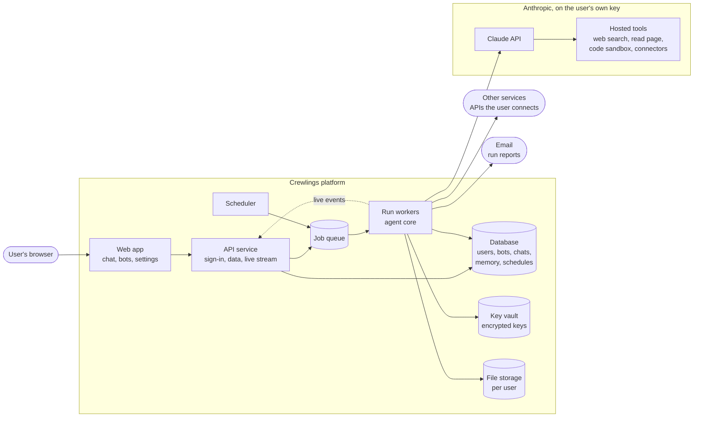

# Crewlings platform architecture

**Status:** proposal for review. Nothing here is built yet.

Crewlings today is a program one person runs on their own machine. This document describes how it becomes a public product: anyone can sign up, each person gets their own chats, bots, memory and schedules, and each person pays for their own AI use with their own Anthropic API key.

## What changes, in one table

| | Today (single user) | Platform (public) |
| --- | --- | --- |
| Who uses it | One person, no accounts | Anyone who signs up |
| Where it runs | Your computer or one server | Hosted services, always on |
| Storage | JSON files in a folder | A database, with every row owned by one user |
| AI key | One key in a settings file | Each user's own key, encrypted |
| Running code | A shell on the host machine | An isolated sandbox, never our servers |
| Agents | One agent | One agent core, many bots defined as settings |
| Work in progress | Lives in the server's memory | Queued jobs, picked up by workers |

The riskiest line is "running code". On your own machine, the agent's shell can only hurt you. On a public service, a stranger's agent must never be able to touch the server or another user's data. The whole design is shaped around that.

## The map

## The parts

**Web app.** The page people use: regular chat, the bots gallery, a bot editor, memory, schedules, settings. It holds no secrets and talks only to the API service.

**API service.** Signs people in, reads and writes their data, accepts messages, and streams live progress to the page. It never runs an agent itself, so it stays fast and can be restarted at any time without losing work.

**Job queue.** Every agent run (a message you send, a scheduled job, a bot called from a chat) becomes a job. This is what lets runs survive restarts and lets the platform control how many run at once.

**Run workers.** Programs that take jobs from the queue and run the agent core: send the conversation to Claude, run the tools Claude asks for, save each step, publish live events. Add more workers to handle more users.

**Agent core.** The loop that already exists in `src/agent.js`, kept and moved into the workers. It gains one idea: it runs a *bot definition* on behalf of a *user*, and can only see that user's data.

**Scheduler.** Checks the database for scheduled jobs that are due and puts them on the queue. It makes sure a job fires once even when several copies of the scheduler are running.

**Database.** Replaces the JSON files. Every row carries the id of the user who owns it, and the database itself enforces that one user can never read another's rows.

**Key vault.** Each user's Anthropic key, and any keys they store for other services, encrypted. Only workers can decrypt them, only for the run that needs them. The browser only ever sees the last four characters.

**File storage.** Each user's files, in their own area. The agent reaches them through a file tool that is locked to that area.

## Bots

A bot is not a separate program. It is a saved set of settings that the one agent core runs:

| Setting | Example (Scout) |
| --- | --- |
| Name and character | Scout, the research character |
| Instructions | "You are a careful researcher. Quote exactly, always give the link." |
| Tools it may use | Web search, read page. No files, no API calls. |
| Model and effort | The user's default, or its own |
| Memory | Shares the user's main memory, plus notes of its own |
| Schedule | None, or "every day at 8:00" |
| What needs approval | For example: any API write |

Regular chat is simply the default bot, with every tool switched on.

Three kinds of bot, built in this order:

1. **Starter bots.** A set that ships with the product, so a new user has something useful on day one.
2. **Your own bots.** Users create and edit bots, by form or by asking Crewlings to make one.
3. **Shared bots.** Users publish a bot for others to copy. This is the step that turns a tool into a platform, and it comes last because it needs review and moderation.

Bringing a bot into a regular chat with `@` works by running that bot as a short side job and handing its answer back to the chat.

## Tools on a public service

| Tool | Where it runs | Notes |
| --- | --- | --- |
| Web search, read page | Anthropic | Under the user's key |
| Code | Anthropic's hosted code sandbox | Replaces the host shell. Nothing runs on our servers. |
| Files | Our file tool | Locked to the user's own storage |
| Memory, skills, schedules, chat search | Our workers | Plain database reads and writes, scoped to the user |
| API calls with stored keys | Our workers | Each key tied to one host; private network addresses blocked |
| Connectors (MCP) | Anthropic | Per user, with the user's own sign-in to each service |
| Real browser | Not in the first release | Needs a hosted browser sandbox; added later if wanted |

The host shell and the local file editor do not exist in the hosted product. They remain in the self-hosted edition only.

Approvals stay: actions that change something outside Crewlings (an API write, sending a message) wait for the user's yes, shown in the chat and in an approvals inbox for scheduled runs.

## What is stored

| Table | Holds |
| --- | --- |
| users | Account, plan, limits |
| api_keys | The user's Anthropic key and service keys, encrypted |
| bots | Bot definitions, including starter and shared ones |
| conversations, messages | Chats, each tied to a user and a bot |
| runs, run_events | Every agent run and its step-by-step record, for live view and replay |
| approvals | Actions waiting for a yes or no |
| memory, skills | Per user, optionally per bot |
| schedules | What runs when, and when it last ran |
| files | Index of the user's stored files |
| usage | Runs, tokens and storage per user, for limits and later billing |
| audit_log | Sign-ins, key changes, bot publishing |

## What happens when a user sends a message

1. The page sends the message to the API service.
2. The API saves it, creates a run, puts a job on the queue, and answers at once.
3. A worker takes the job, loads the bot definition, the user's memory and the conversation, and decrypts the user's Anthropic key for this run only.
4. The worker calls Claude and publishes each piece of the reply as a live event. The API relays those events to the page.
5. When Claude calls a tool, the worker checks the bot is allowed to use it, asks for approval if needed, runs it inside the user's own scope, and returns the result to Claude.
6. Steps 4 and 5 repeat until Claude is done. Every step is saved, so a reload, a dropped connection or a restarted worker loses nothing.

A scheduled job is the same from step 2 on, started by the scheduler instead of a person, and ends with an email report.

## Keeping users apart, and keeping the service safe

- **Data isolation.** Ownership is checked in the database itself, not only in code, so a bug in one screen cannot leak another user's data.
- **No code on our servers.** Agent-written code runs only in Anthropic's sandbox.
- **Keys.** Encrypted at rest, decrypted only inside a worker for one run, never logged, never sent to the browser, deletable at any time.
- **Outbound requests.** The API-call tool refuses private and internal addresses, and stored keys only go to their own host.
- **Untrusted content.** Web pages and tool results are treated as information, not instructions, and a bot can only ever act within its owner's account and its own allowed tools. That limits what a malicious page can achieve.
- **Limits per user.** Runs at once, steps per run, schedule frequency, storage. Users pay Anthropic for AI use, but workers and storage are our cost, so limits protect the service.
- **Account basics for a public product.** Terms of use, a privacy policy, data export, and full deletion of an account and everything it owns.

## Services

| Part | Service | Status | Why |
| --- | --- | --- | --- |
| Database, sign-in, file storage | Supabase, hosted | **Decided** | One service covers all three, with per-user row protection built in. Free plan while testing, Pro plan at launch for backups and no pausing. |
| Job queue | Inside the same database | Follows from Supabase | No extra service to run at this size |
| Web app, API service and run workers | Render | **Decided** | Agent runs last minutes and the scheduler must stay awake, which website hosts such as Vercel and Netlify do not allow. The web app is served from the same service at first. |
| Email | Resend | Recommended | Sign-in emails and run reports; account already exists |
| AI | Anthropic, each user's key | **Decided** | Users pay for their own AI use |

Supabase is open source and built on standard PostgreSQL, so the database can later move to a self-hosted setup without rewriting the app.

### Running costs

List prices from third-party pricing guides in November 2026; confirm on each provider's own pricing page. The growth row is an estimate.

| Stage | Render | Supabase | Resend | Total per month |
| --- | --- | --- | --- | --- |
| Testing, a handful of users | $7 to $25 | $0 | $0 | $7 to $25 |
| Public launch, up to a few hundred users | $32 | $25 | $0 to $20 | $57 to $77 |
| Growth, a few thousand users | About $100 to $200 | $25 plus a larger database | $20 to $35 | Roughly $150 to $300 |

Cost grows with the number of agent runs at once, not with sign-ups. AI use is not in the table because each user pays Anthropic directly.

The code moves from plain JavaScript to TypeScript during the restructure, because a multi-part product benefits from checked types at the boundaries between parts.

## Open source, two editions

Crewlings is open source under the MIT licence. Anyone can read the code, run it themselves, and build on it. The licence covers the code; the Crewlings name and characters are the brand.

The agent core is shared. Around it:

- **Crewlings Local** is what exists today: one user, files on disk, host shell allowed. It stays, because an open-source project has to be runnable by anyone on their own machine.
- **Crewlings Cloud** is the hosted platform: accounts, database, workers, hosted tools only. Its code is in the same public repo.

## Build order

Each stage ends with something usable.

| Stage | What gets built | You can then |
| --- | --- | --- |
| 0. Restructure | Split the code into core, local and cloud. No new features. | Keep running Local exactly as now |
| 1. Accounts and chat | Sign-in, database, key vault, queue and workers, regular chat with web and code tools | Invite a few testers who bring their own key |
| 2. Bots | Bot definitions, starter bots, gallery, editor, characters, per-bot memory | Use and create bots |
| 3. Autonomy | Schedules, approvals inbox, email reports | Have bots work on their own |
| 4. Files and connections | File storage and tool, stored service keys, connectors | Have bots work with your files and other services |
| 5. Public launch | Limits, monitoring, backups, terms and privacy, onboarding, data export and deletion | Open sign-ups |
| 6. Shared bots | Publishing, review, copying | Let users share bots with each other |

## What carries over from today's code

The agent loop, tool input checks, approvals, schedule parsing, the Markdown renderer, the tests and the mock API used by the tests. The JSON file store, the host shell tool and the single-password sign-in are replaced.

## Decisions still open

1. **Engine.** This plan keeps our own agent loop, which is built and tested. The alternative is Anthropic's Managed Agents, where Anthropic runs the loop and a sandbox per session; it would remove the workers from our side, at the price of depending on a beta product and having less control. The plan keeps the engine behind one boundary so it can be swapped later. Recommendation: own loop now, revisit at stage 3.
2. **Local edition.** Decided: it stays, as part of being open source.
3. **How Crewlings earns money.** With users bringing their own key, AI use costs you nothing, but hosting does. Because the code is open source, the hosted service is what people would pay for; a platform subscription is the usual answer. It is not in the build order above; if you want it, it slots in at stage 5.
4. **Character and theme direction.** The game-style direction (bots as a crew that goes on quests) is the current front-runner over A to D from the earlier mockups. It only affects stage 2 onward.
